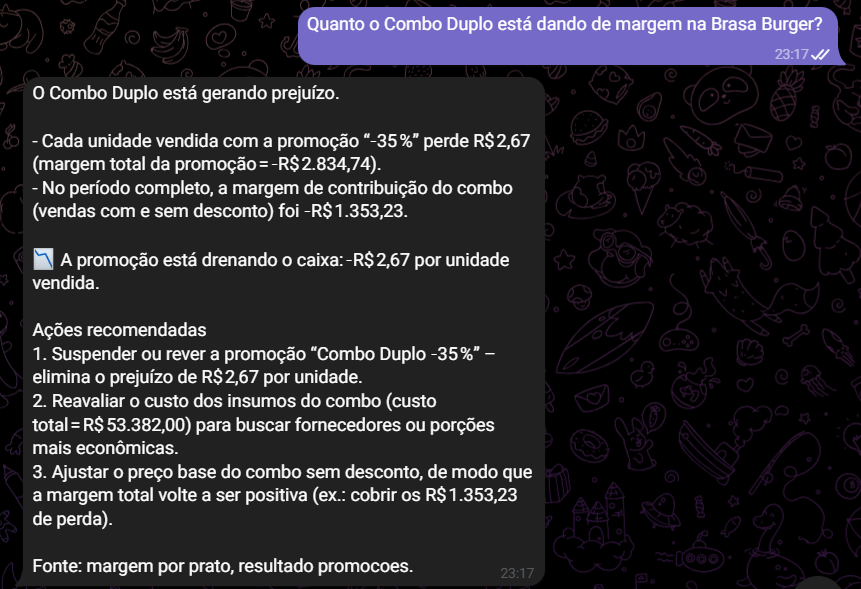
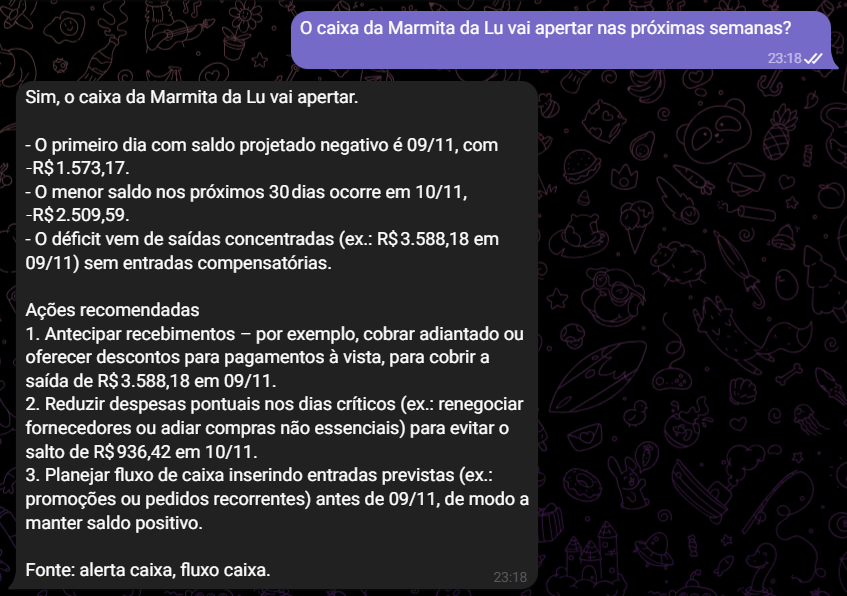
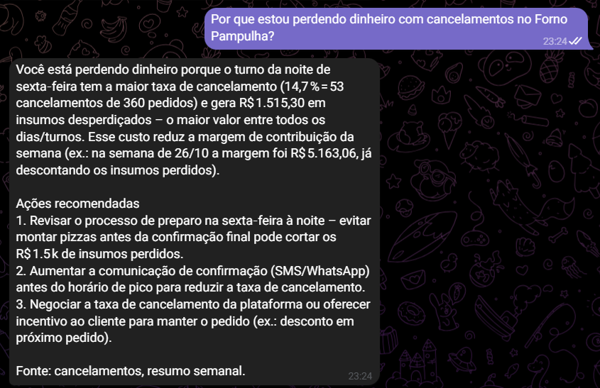
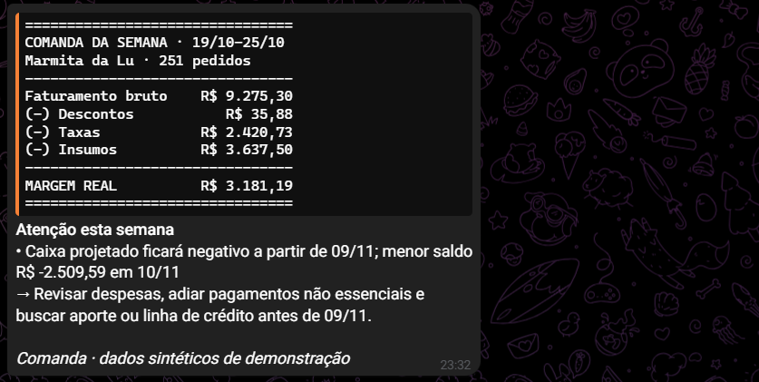
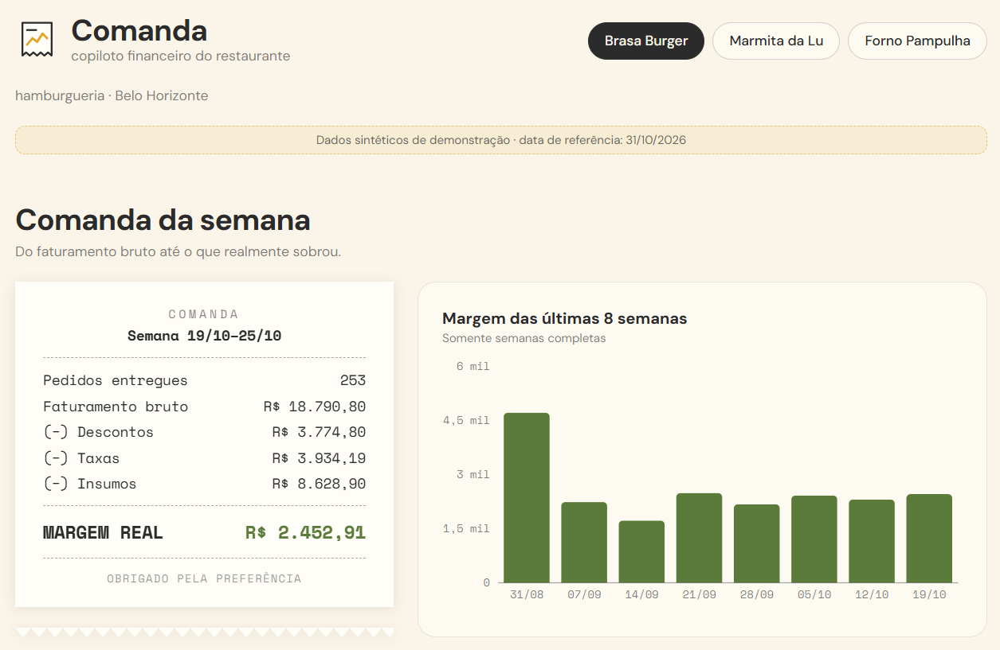
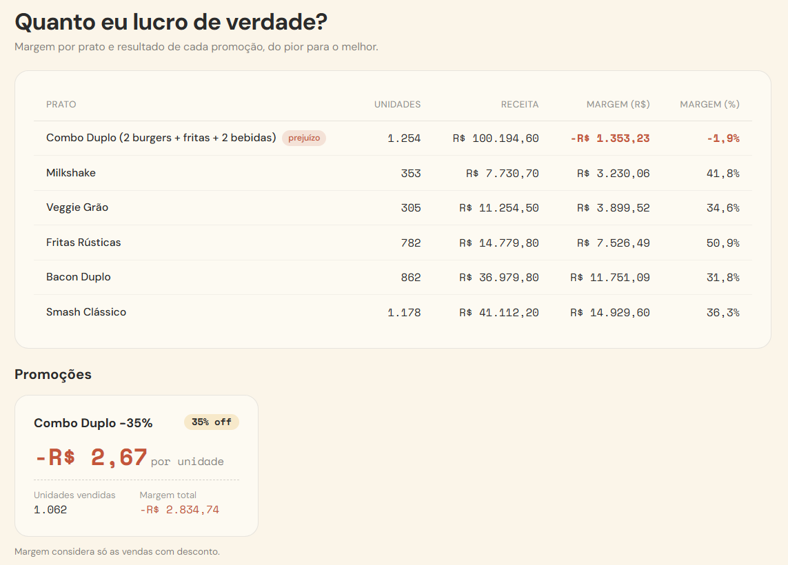
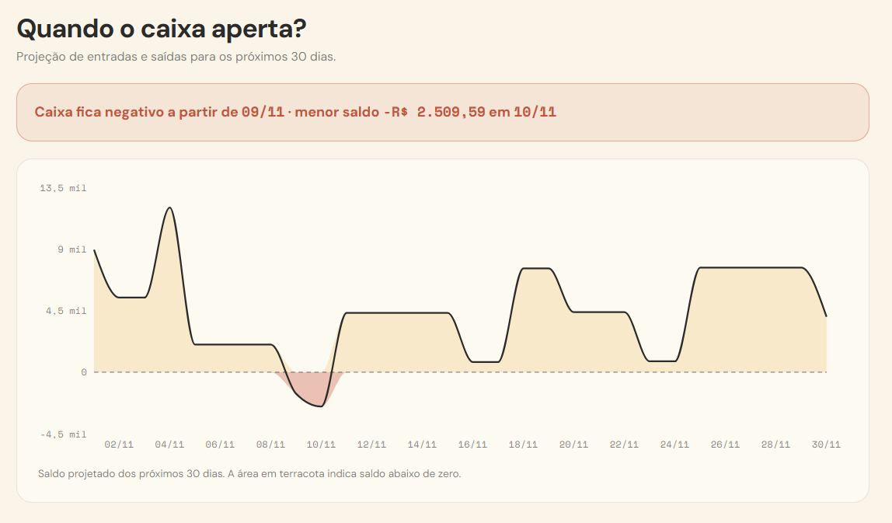
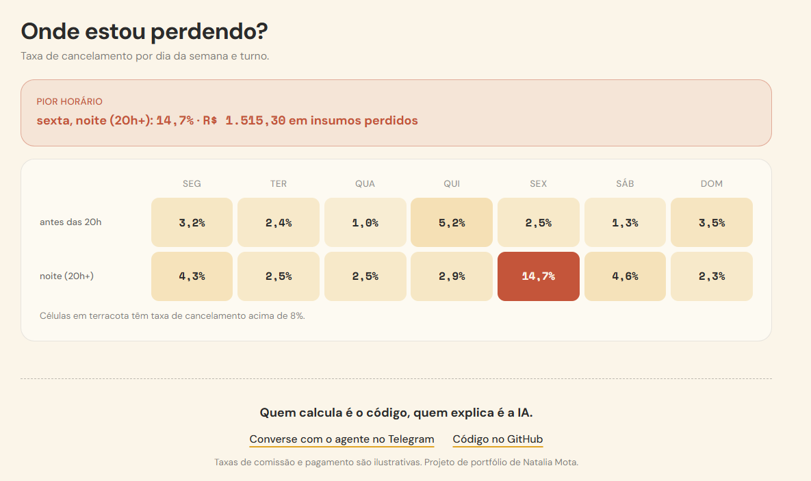
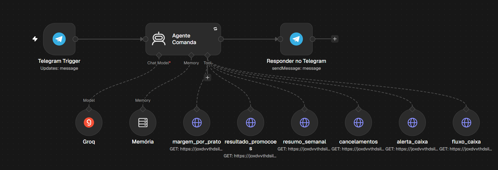

# Comanda — copiloto financeiro do restaurante

> Agente de IA que mostra ao dono de restaurante **quanto ele lucrou de verdade**, **quando o caixa vai apertar** e **o que fazer a respeito**, sem ele precisar abrir uma planilha.

**Status:** MVP no ar (nov/2026) · dados 100% sintéticos · taxas ilustrativas

**▶ Dashboard ao vivo:** https://v0-comanda-dashboard.vercel.app · **💬 Agente no Telegram:** [@comanda_natalia_bot](https://t.me/comanda_natalia_bot)

---

## Veja funcionando

> O agente roda no n8n Cloud e pode estar fora do ar quando você ler isto. Os prints abaixo são de execuções reais, com os números conferidos contra o banco.

**1. O dono pergunta em português, e o agente acha a causa.** O Combo Duplo é o item mais vendido da hamburgueria, mas a promoção de 35% faz cada unidade dar prejuízo. O agente consulta a margem por prato *e* o resultado das promoções antes de responder, e separa as duas métricas.



**2. Avisa antes de o caixa ficar negativo.** A projeção de 30 dias cruza repasses previstos com despesas agendadas e mostra o dia em que o saldo fica negativo.



**3. Mostra onde o dinheiro vaza.** Na pizzaria, sexta à noite concentra os cancelamentos (14,7%) e os insumos jogados fora.



**4. Toda segunda às 8h, a comanda da semana chega sozinha.** O fechamento vem formatado pelo código; a IA só escreve o "Atenção esta semana", usando apenas os fatos que recebe.



**5. Painel público**, lendo as mesmas views (chave pública, só leitura):

| Comanda da semana | Margem por prato e promoções |
|---|---|
|  |  |
| **Caixa projetado** (área terracota = saldo negativo) | **Mapa de cancelamentos** por dia e turno |
|  |  |

**6. Por dentro:** o agente no n8n. Cada ferramenta é uma chamada HTTP a uma view SQL; o modelo escolhe qual chamar.



---

## O problema

A maior parte dos restaurantes em plataformas de delivery são pequenos e médios negócios. O dono vê o **faturamento**, mas não vê:

- a **margem real** de cada prato depois de comissão, taxa de pagamento, desconto e insumos;
- se uma **promoção** que "vende muito" está, na verdade, dando prejuízo;
- **quando o caixa fica negativo**, porque os repasses chegam semanalmente e aluguel e folha vencem em datas fixas.

O resultado são decisões no escuro e a busca por crédito só quando já é tarde.

## A solução

| Peça | O que faz | Ferramenta |
|---|---|---|
| **Camada de métricas** | Calcula margem por prato, resultado de promoções, cancelamentos e fluxo de caixa projetado. 100% determinística. | PostgreSQL (Supabase) — views SQL |
| **API para o agente** | Cada view vira um endpoint REST que o agente consulta como ferramenta | Supabase REST (sem backend próprio) |
| **Agente conversacional** | O dono pergunta em linguagem natural ("quanto lucrei no fim de semana?") e o agente consulta as ferramentas antes de responder | n8n AI Agent + Groq (`gpt-oss-120b`) |
| **Automação semanal** | Toda segunda: lê as métricas, gera um diagnóstico com até 3 ações priorizadas e envia ao dono | n8n (cron) + Groq + Telegram |
| **Dashboard** | Painel com margem por prato, promoções e o gráfico de caixa projetado | Vibe coding no v0 + Vercel, lendo as views do Supabase com a chave pública (só leitura) |
| **Loop de feedback** *(planejado)* | O dono marcará cada recomendação como útil/não útil para orientar a melhoria dos prompts. A tabela e a permissão de escrita já existem; a interface ainda não | Tabela `feedback_recomendacoes` |

### A comanda da semana

Toda segunda, o dono recebe uma **comanda**: o fechamento da semana no formato que ele já conhece do balcão.

```
================================
  COMANDA DA SEMANA · 19/10-25/10
  Brasa Burger · 253 pedidos
--------------------------------
  Faturamento bruto    R$ 18.790,80
  (-) Descontos        R$  3.774,80
  (-) Taxas plataforma R$  3.934,19
  (-) Insumos          R$  8.628,90
--------------------------------
  MARGEM REAL          R$  2.452,91
================================
  ⚠ Combo Duplo -35%: -R$ 2,67/un
================================
```
*(números reais da camada de métricas, view `v_resumo_semanal`, sobre os dados sintéticos; margem real = margem de contribuição, antes de custos fixos)*

### Princípio de design: quem calcula é o código, quem explica é a IA

LLMs erram contas. Em finanças, um número inventado é inaceitável. Por isso:

1. **Todo número vem do SQL.** O modelo nunca soma, divide ou estima valores.
2. **O agente é obrigado a chamar uma ferramenta** antes de citar qualquer valor, e cita a fonte (a view).
3. **Recomendações são apoio à decisão**, sempre com o cálculo visível.
4. **Avaliação objetiva (evals):** as respostas do agente são comparadas com um gabarito calculado em SQL.

## Por que isso importa para uma plataforma de delivery

Hipóteses de produto que o protótipo ilustra (não resultados medidos):

- **Crédito na hora certa.** No caso da marmitaria, o caixa fica negativo em 09/11, mas o repasse chega em 11/11: é um descompasso de datas, não falta de dinheiro. Enxergar isso com antecedência é o momento certo para oferecer capital de giro, antes do aperto e não depois.
- **Restaurante saudável fica.** Quem entende a própria margem decide melhor, sobrevive mais e continua vendendo na plataforma.
- **Promoções sustentáveis.** Mostrar a margem por unidade antes de entrar numa promoção evita o caso "vende muito e dá prejuízo".
- **Experiência do cliente final.** Cancelamento concentrado num turno também é pedido frustrado para quem comprou.
- **Complementar, não concorrente.** Assistentes para restaurantes costumam cobrir vendas e operação; o Comanda é a camada de **margem, caixa e decisão**, que poderia ser uma funcionalidade dentro deles.

## Arquitetura

```
 dados sintéticos (Python) ──► Supabase/Postgres
                                  │  views: v_margem_prato, v_promocao_resultado,
                                  │         v_resumo_semanal, v_cancelamentos,
                                  │         v_fluxo_caixa, v_alerta_caixa
                                  ▼
                           API REST (Supabase)
                     ┌────────────┼──────────────┐
                     ▼            ▼              ▼
             n8n: agente     n8n: relatório   Dashboard
             (chat Telegram)  semanal (cron)  (Vercel)
                     └──────►  LLM (Groq) ◄────┘
                               │
                     feedback do dono ──► tabela de feedback
```

## Dados sintéticos

Três restaurantes fictícios em Belo Horizonte, 90 dias de operação (03/08 a 31/10/2026), ~9,3 mil pedidos.
Gerados por `data/generate.py` (semente fixa, reprodutível). Três padrões foram plantados para servirem de **gabarito** dos evals:

| Restaurante | Padrão plantado | O que a camada de métricas mostra |
|---|---|---|
| **Brasa Burger** | Promoção "Combo Duplo -35%" vira campeã de vendas | Margem de **-R$ 2,67 por combo vendido** (prato mais vendido, margem negativa) |
| **Marmita da Lu** | Margens saudáveis, mas aluguel e folha concentrados no início do mês | Caixa **negativo em 09/11**, mínimo de **-R$ 2,5 mil** em 10/11, recupera em 11/11 |
| **Forno Pampulha** | Cancelamentos altos na sexta à noite | **14,7%** de cancelamento na sexta após 20h (vs. ~3% nos outros turnos), R$ 1,5 mil em insumos perdidos |

> Taxas de comissão (23%) e pagamento (3,2%) são **ilustrativas** e configuráveis na tabela `restaurantes`. Não representam condições comerciais reais de nenhuma plataforma.

## Identidade visual

| Elemento | Escolha |
|---|---|
| Conceito | Comanda/cupom de restaurante: o financeiro "anotado" para o dono |
| Cores | Papel `#FBF5E9` · Tinta `#2B2B2B` · Mostarda `#E0A526` · Oliva (positivo) `#5B7B3A` · Terracota (alerta) `#C4553A` |
| Tipografia | Space Mono (números, estilo cupom) · DM Sans (textos) |
| Logo | Comanda com borda serrilhada e uma linha de gráfico/✓ |

## Como rodar

No **SQL Editor do Supabase**, rode os arquivos de `db/` nesta ordem:

| Ordem | Arquivo | O que faz |
|---|---|---|
| 1 | `01_schema.sql` | Cria as tabelas (pode rodar de novo: apaga e recria) |
| 2 | `02a_dados_cadastro.sql` | Restaurantes, pratos, promoções, despesas e repasses |
| 3 | `02b_dados_pedidos.sql` | ~9,3 mil pedidos |
| 4 | `02c_dados_itens.sql` | ~13 mil itens de pedido |
| 5 | `03_views.sql` | Camada de métricas |
| 6 | `04_seguranca.sql` | Row Level Security: a chave pública só lê métricas e grava feedback |

Para regerar os dados: `python3 data/generate.py && python3 data/to_sql.py`.
Teste local com Postgres: `./reload.sh`.

## Roadmap

- [x] Modelo de dados + gerador sintético com padrões plantados
- [x] Camada de métricas determinística (views SQL)
- [x] Supabase + endpoints REST (PostgREST, RLS só-leitura)
- [x] Workflows do n8n prontos para importar (`n8n/`)
- [x] Agente n8n + Groq com 6 ferramentas, rodando no Telegram
- [x] Relatório semanal automático (n8n, toda segunda 8h → Telegram)
- [x] Dashboard publicado (v0 + Vercel)
- [x] Despertador diário do Supabase (GitHub Actions) para o dashboard não sair do ar
- [ ] Evals: 12 perguntas com gabarito SQL ([`evals/perguntas.md`](evals/perguntas.md)) — rodada em andamento
- [ ] Interface de feedback do dono sobre as recomendações

## Limitações conhecidas

- **Plano gratuito do Groq:** cerca de 8 mil tokens por minuto. Perguntas seguidas podem estourar o limite; o workflow tenta de novo automaticamente, mas o ideal é espaçar as perguntas.
- **Dados sintéticos** e **taxas ilustrativas**: o objetivo é demonstrar a arquitetura e o método, não descrever um restaurante real.
- **Agente no n8n Cloud (trial):** pode estar desligado; os workflows estão em `n8n/` para importar em qualquer instância.
- O agente ainda erra em pontos documentados em [`n8n/APRENDIZADOS.md`](n8n/APRENDIZADOS.md), principalmente ao sugerir ações (tende a fazer contas por conta própria).
